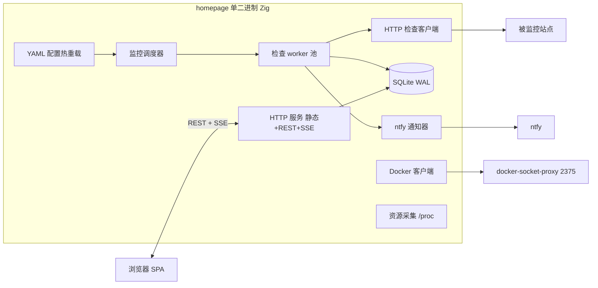

# foyer：导航面板 + 监控 合并自建程序 · 方案 v1.0

> 2026-08-22 起草，同日定稿。参考：`gx_server/docs/homepage-uptime-kuma.md`（现网 gethomepage + Uptime Kuma 完整导出）。
> 技术决策已全部确认（见文末「决议记录」），可直接开工。

## 1. 目标

用**一个自建程序**替换现网两个服务：

| | 现服务 | 合并后 |
|---|---|---|
| 导航面板 | gethomepage（home.xeed.ink） | `/` 主面板 |
| HTTP 监控 | Uptime Kuma（status.xeed.ink） | 内置监控引擎 |
| 通知 | Kuma → ntfy | 内置 ntfy 通知器 |
| 状态页 | Kuma /status/default | `/status` 公开页 |

合并收益：

- 卡片状态点与监控同源，不用两套系统互相猜
- 少维护一个容器、一个域名、一份配置
- uptime% / 延迟可以直接显示在服务卡片上
- 自建以学习为主（工作目录在 `learning/zig/`）

非目标（v1）：

- 多用户 / 团队协作
- Kuma 的几十种监控类型与通知渠道（v1 只做 HTTP(s) GET + ntfy）
- 历史心跳数据迁移（Kuma 旧数据留在旧卷）

## 2. 现状功能盘点（parity 清单）

### 2.1 来自 Homepage

| 功能 | 现状 | 合并后 |
|---|---|---|
| 服务分组卡片 | 2 组 × 4 列 row | 保留，YAML 兼容现有 `services.yaml` |
| 卡片字段 | icon / href / description / siteMonitor / server+container | 全保留 |
| 书签 | 2 组 iconsOnly | 保留 `bookmarks.yaml` |
| 外观 | dark / teal / 背景图 blur / 中文 / 全宽 | 保留 `settings.yaml` |
| 资源 widget | CPU / 内存 / 磁盘 / | 保留，读 `/proc` 实现 |
| 搜索框 | DuckDuckGo，_blank | 保留（纯前端实现） |
| Docker 状态 | socket-proxy 只读 CONTAINERS=1 | 复用同一个 docker-socket-proxy |

### 2.2 来自 Uptime Kuma

| 功能 | 现状 | 合并后 |
|---|---|---|
| HTTP(s) 监控 | 6 项，间隔混乱（600s ~ 600000s，录入失误） | 默认统一 300s，按项可配 |
| 心跳历史 | SQLite kuma.db | SQLite，原始 45 天 + 每日聚合长期保留 |
| 重试语义 | 重试 N 次才判 Down | 对齐：失败快速重试 retry_max 次 → Down |
| 通知 | ntfy token 认证，up=3 / down=5，挂监控 1–5 | ntfy 通知器，语义一致，可挂任意监控 |
| 状态页 | 标题 az0，组「服务」5 项，300s 刷新，显示证书过期 | `/status` 单页公开，SSE 实时刷新 |
| 管理 UI | Web 增删改监控 | `/admin` 单用户登录后 CRUD |

## 3. 产品形态

页面：

- `/` 主面板（公开）：分组卡片（状态点 + 延迟 + uptime%）、书签条、搜索框、资源条、Docker 概况
- `/status` 公开状态页：当前状态、30 天 uptime 条、平均延迟、事件历史
- `/admin` 管理页（登录）：监控项 CRUD、通知配置、事件查看、YAML 手动重载

合并的核心设计——**服务即监控**：
所有内容存 SQLite；服务卡片可直接开启监控（同一行数据），卡片状态点即监控状态，无需两处配置。admin 里也可建不上面板的独立监控项。

## 4. 架构



线程模型：

- 调度线程：1s tick 扫描到期 monitor → 任务队列
- worker 池（约 4 线程）：执行 HTTP 检查，结果写库 + SSE 广播
- SQLite 单写队列（WAL + busy_timeout），读多写少无压力
- 状态翻转（up↔down）→ 开关 incident → SSE 推送 → ntfy 通知

## 5. 技术选型

### 5.1 后端（推荐 Zig）

| 方案 | 优点 | 缺点 | 结论 |
|---|---|---|---|
| **Zig 0.15.x** | 单二进制、内存极小、C 互操作强、与学习目标一致 | 生态年轻、库与编译器版本强绑定、TLS 细节要自己趟 | ✅ 推荐 |
| Go | 轮子最全、交付最快 | 学不到新东西，与目录意图不符 | 备选 |
| Rust (axum) | 生态成熟 | 学习曲线陡，对本项目体量偏重 | 备选 |
| TS (Hono/Bun) | 前后端同语言 | 常驻内存高 | 不推荐 |

Zig 依赖（vendor 进 `build.zig.zon`，锁版本提交 lock 文件）：

> 工具链已核实（2026-08-22）：本机经 zvm 装的是 `0.17.0-dev`，而三个库只保证 **Zig 0.16.0 稳定版**，项目统一用 zvm 里的 0.16.0。
> 实际拉取时发现：http.zig 的传递依赖（metrics/websocket）上游 zon 钉的 SHA tarball 已 404；zig-yaml main 在 0.16 下 build 脚本本身编不过（用了已移除的 std.StringArrayHashMap）。故三个库全部 vendor 进 `vendor/` 并打兼容补丁（见 R1/R3/R6），构建可离线复现。

| 用途 | 库 | 核实结果 |
|---|---|---|
| HTTP 服务 | karlseguin/http.zig | master 支持 0.16（自带路由/中间件/SSE/WebSocket）|
| SQLite | karlseguin/zqlite.zig | master 支持 0.16，2026-07 仍在活跃更新 |
| TLS | std.http.Client（std.crypto.tls） | TLS 1.2/1.3 可用；对端证书不暴露，见风险 R2 |

> ~~zig-yaml~~：已决策弃用 YAML 配置（见 5.3），该依赖移除。

性能备注（2026-10 公开基准，Pi5 / 100 并发）：zap 121k req/s ≈ http.zig 120k >> std.http 72k。本项目单用户面板量级在个位数 rps，性能不构成选型因素；选 http.zig 是为了内置路由/中间件/SSE 与纯 Zig 无 C 依赖。

### 5.2 前端（推荐 Svelte 5 + Vite + TypeScript + UnoCSS）

| 方案 | 优点 | 缺点 | 结论 |
|---|---|---|---|
| **Svelte 5 + Vite + TS + UnoCSS** | 产物小、响应式直观、EventSource/SSE 好写、可嵌二进制 | 需要 Node 构建链（仅构建期） | ✅ 已确认 |
| htmx + 服务端模板 | 无 Node 构建链 | 实时图表/交互别扭；Zig 模板生态弱 | 备选 |
| React | 生态最大 | 产物大、样板多，过重 | 不推荐 |
| vanilla TS | 零依赖 | 状态管理手写，维护费劲 | 不推荐 |

要点：

- 构建产物 `dist/` 在 `build.zig` 里 `@embedFile` 嵌入二进制，单文件交付；开发时可用运行时 `./public` 目录覆盖
- 图表不引库：uptime 条 = div 网格（Kuma 同款观感），延迟 sparkline 手写 SVG
- 图标 vendor 所需的 dashboard-icons（约 20 个）进 `public/icons/`，不依赖运行时 CDN
- 中文单语言硬编码，不做 i18n

### 5.3 存储

- **SQLite（WAL）唯一存储**：监控项、心跳、每日聚合、事件、通知、会话，以及面板内容（设置/分组/服务/书签）全部入库
- 不再使用任何配置文件；`reference/config/*.yaml` 仅作为一次性导入的数据源（手工转成 seed，不做 YAML 解析器）
- 备份 = 备份单个 sqlite 文件
- 保留策略：原始心跳 45 天；每日 rollup 长期；启动时和每天清理

### 5.4 部署

- 多阶段 Dockerfile：Node 构建前端 → `zig build -Doptimize=ReleaseSafe`（Zig 0.16.0）→ 运行镜像 scratch/distroless + ca-certificates + tzdata
- compose 两服务：`homepage` + `dockerproxy`（沿用现有 socket-proxy，CONTAINERS=1 只读）
- Caddy：单域名 `home.xeed.ink`；`status.xeed.ink` 301 → `/status`（是否保留双域名待定 Q7）
- 资源目标：RSS < 30MB，空闲 CPU ≈ 0

## 6. 数据模型（草案）

```sql
monitors(
  id INTEGER PRIMARY KEY,
  name TEXT NOT NULL,
  url TEXT NOT NULL,
  method TEXT DEFAULT 'GET',
  interval_s INTEGER DEFAULT 300,
  timeout_ms INTEGER DEFAULT 10000,
  retry_max INTEGER DEFAULT 2,
  retry_interval_s INTEGER DEFAULT 60,
  accepted_min INTEGER DEFAULT 200,
  accepted_max INTEGER DEFAULT 299,
  keyword TEXT,                -- 可选关键词匹配
  public INTEGER DEFAULT 1,    -- 是否上状态页
  enabled INTEGER DEFAULT 1,
  source TEXT DEFAULT 'manual',-- 'yaml' | 'manual'
  created_at INTEGER
);

heartbeats(
  id INTEGER PRIMARY KEY,
  monitor_id INTEGER REFERENCES monitors(id) ON DELETE CASCADE,
  ts INTEGER, status INTEGER,   -- 1 up / 0 down
  latency_ms INTEGER, message TEXT
);
CREATE INDEX idx_hb ON heartbeats(monitor_id, ts);

rollup_daily(monitor_id, date TEXT, up INTEGER, down INTEGER,
             avg_latency_ms INTEGER, PRIMARY KEY(monitor_id, date));

incidents(id INTEGER PRIMARY KEY, monitor_id, started_at, ended_at, message);

notifications(id INTEGER PRIMARY KEY, type TEXT, config_json TEXT, is_default INTEGER);
monitor_notification(monitor_id, notification_id, PRIMARY KEY(monitor_id, notification_id));

sessions(token TEXT PRIMARY KEY, expires_at INTEGER);
-- 单用户密码存 env 初始化后的 hash 表或直接 KV 表
```

uptime% 计算：≤45d 从 heartbeats 聚合；更早走 rollup_daily。

## 7. API 草案

```
GET  /api/config                     # 面板内容（YAML 解析结果 + 实时状态合并）
GET  /api/docker/containers          # 容器列表/状态
GET  /api/status/:slug               # 状态页数据（公开）
GET  /api/monitors                   # 列表+当前状态+uptime%（admin）
POST /api/monitors                   # 新建
PUT  /api/monitors/:id               # 修改
DELETE /api/monitors/:id             # 删除
GET  /api/monitors/:id/heartbeats?hours=24
GET  /api/incidents?limit=50
PUT  /api/notifications/:id          # ntfy 配置
POST /api/login | POST /api/logout
GET  /api/events                     # SSE：status / resources / docker 三类事件
```

SSE 节流：status 即时推；resources 3s；docker 30s。

## 8. 监控引擎

- 调度线程 1s tick，到期 monitor 入队；worker 池并发检查
- 检查 = HTTP GET，接受 200–299，可选关键词匹配，超时默认 10s
- 失败语义（Kuma 对齐）：失败 → 按 retry_interval 快速重试 retry_max 次 → 仍失败判 Down → 开 incident + ntfy(priority 5)；恢复 → 关 incident + ntfy(priority 3)
- YAML `siteMonitor` 自动注册：source='yaml'，URL 幂等；YAML 里删掉对应项 → 监控禁用（历史数据保留）
- admin 手动建的监控 source='manual'，删了就真删

## 9. 通知

- Notifier 接口（vtable）：`send(title, body, priority)`
- v1 只实现 ntfy：POST `{server}/{topic}`，Bearer token，priority up=3 / down=5，与现网行为一致
- 只有状态翻转才发通知，重试期不发

## 10. 认证（推荐方案）

- `/` 与 `/status` 公开（与现状一致）
- `/admin` + 写接口：单用户密码登录；**首次启动自动生成随机密码并打印到日志（仅此一次）**，argon2id 存库，登录后可在 admin 改密
- 备选：完全不做登录，`/admin` 靠 Caddy basic auth（省实现，体验差一点）

## 11. 迁移步骤

1. `services.yaml` / `bookmarks.yaml` / `settings.yaml` 基本原样拷贝（schema 做兼容设计）
2. 6 个监控项在 admin 里手动重建（顺手把间隔统一为 300s）；或写一次性 seed SQL
3. ntfy token 复用或去 ntfy 新发一个
4. Caddy 切换：home.xeed.ink → 新程序；status.xeed.ink 301 到 /status
5. 旧两个 compose 下线；Kuma 数据卷留档不迁移

## 12. 风险

| # | 风险 | 缓解 |
|---|---|---|
| R1 | ~~yaml 库维护问题~~ | 已消除：决策弃用 YAML，全部入库 ✅ |
| R2 | std TLS 不暴露对端证书 | 已决策：v1 不做证书展示 ✅ |
| R3 | Zig/http.zig 升级破坏性大 | 依赖全部 vendor 到 `vendor/`（去 .git 平铺入库），升级=手动换 commit 重验 |
| R4 | SQLite 并发写竞争 | WAL + busy_timeout + 单写队列 |
| R5 | 单人项目功能蔓延 | 严格按里程碑推进，v1 以 parity 为止 |
| R6 | 本机 GCC16 glibc 的 crt1.o 带 .sframe 段，zig 自带 linker 报 R_X86_64_PC64 无法链接 | 默认 target 改为 musl 静态链接（顺带产物适配 Docker scratch）✅ |

## 13. 里程碑

> 进度（2026-08-22）：M0 ✅（骨架+面板+嵌入+seed）、M1 ✅（监控引擎+SSE+实时状态点，端到端验证通过）。开发协作模式：协调者管热点文件与集成，subagent 按文件边界并行实现。

| 里程碑 | 内容 | 验收 |
|---|---|---|
| M0 ✅ | zig http 服务 + 嵌入前端构建链 + SQLite 初始化 + 主面板静态渲染 | 本地打开看到与现网一致的面板内容 |
| M1 ✅ | 调度器 + SQLite + 心跳 + 卡片状态点 + SSE | 卡片红绿点实时变化，重启进程不丢历史 |
| M2 集成 | Docker 容器状态 + 资源条 + 搜索框 | 与现网 widgets 等价 |
| M3 通知 | 重试语义 + incident + ntfy | 停掉某服务能收到 down/up 推送 |
| M4 管理与状态页 | /admin CRUD + 登录 + /status 公开页 | 增删改监控生效，状态页 30 天条正确 |
| M5 上线 | Dockerfile + compose + Caddy 切换 | gx 服务器替换旧双服务，稳定跑一周 |

## 14. 决议记录

| # | 决策点 | 结论 |
|---|---|---|
| 1 | 后端语言 | **Zig 0.16.0**（musl 静态） |
| 2 | 前端 | **Svelte 5 + Vite + TS + UnoCSS** |
| 3 | 鉴权 | 面板与 /status 公开；仅 /admin 单用户密码登录 |
| 4 | 监控项管理 | Web UI + SQLite；服务卡片直接带监控开关 |
| 5 | 证书过期展示 | 不做 |
| 6 | 监控类型 | 仅 HTTP(s) GET |
| 7 | 域名 | 单域名 home.xeed.ink；status.xeed.ink 301 → /status |
| 8 | 项目名 | **foyer**（门厅：进家门先到门厅，所有服务的入口） |

---

## 附录 A：目标配置 schema（基于 reference/ 现网文件逐字段核对）

设计原则：**五个 YAML 文件名与结构保持 1:1 兼容**，现网文件直接拷贝即可用；不认识的字段解析时忽略并打 warning，不做破坏性改名。

### A.1 settings.yaml

| 字段 | v1 支持 | 备注 |
|---|---|---|
| title / description | ✅ | 页面标题与 meta description |
| theme / color | ✅ | dark/light；color 映射到 UnoCSS 主题色变量 |
| headerStyle / fullWidth / cardBlur | ✅ | clean 布局样式 |
| background{image,blur,saturate,brightness,opacity} | ✅ | image 支持本地路径与 URL |
| statusStyle (dot) | ✅ | dot 之外的模式暂按 dot 渲染 |
| showStats / hideVersion / disableIndexing / target / language | ✅ | language 仅 zh-Hans 生效 |
| layout.<组名>.{style,columns,iconsOnly} | ✅ | style=row 横排；columns 1–6 |

### A.2 services.yaml

顶层 = 组列表，组内项字段：`icon` `href` `description` `siteMonitor` `server` `container`。

- `icon`：支持三种写法（现网都在用）——本地文件名（如 `freshrss.png` → `/icons/freshrss.png`）、simple-icons 缩写（`si-xxx`）、完整 URL
- `siteMonitor`：存在则自动注册监控项（source='yaml'，URL 幂等）
- `server`+`container`：关联 Docker 容器状态点
- v1 忽略：`weight`、`className` 等 gethomepage 其余字段

### A.3 bookmarks.yaml

结构与现网一致：组 → 名字 → `[icon, href]` 的单元素列表（gethomepage 特有的嵌套 list 写法，解析器需兼容）。渲染为 iconsOnly 书签条。

### A.4 widgets.yaml

v1 实现两类：

- `resources.{cpu,memory,disk}`：读 /proc/stat、/proc/meminfo、statfs
- `search.{provider,target}`：纯前端跳转；provider 支持 duckduckgo/google/bing/自定义 url 模板

### A.5 docker.yaml

`<名称>:{host,port}` 多实例结构保留；v1 通常只有 my-docker→dockerproxy:2375。GET /containers/json 只读。
